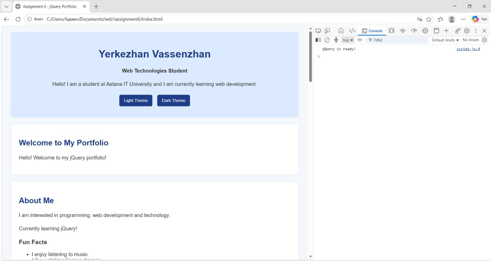
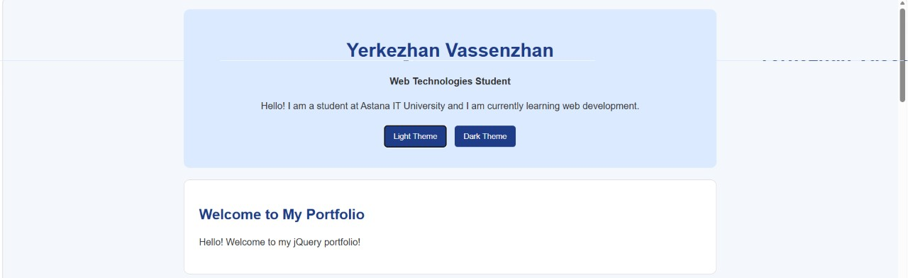
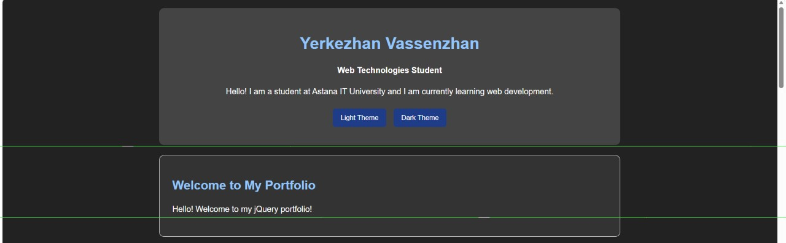
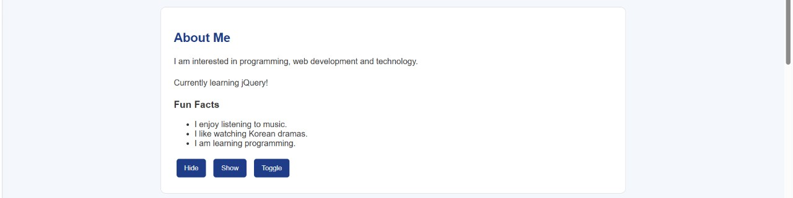
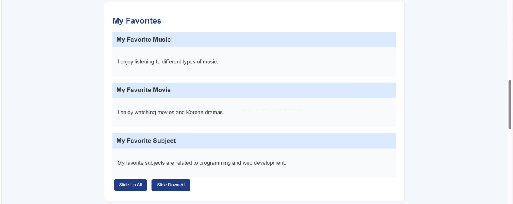
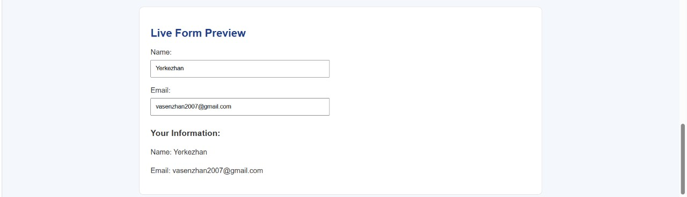
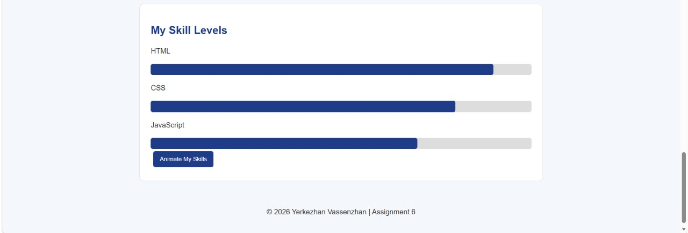

# Assignment 6 - jQuery

**Name:** Yerkezhan Vassenzhan  
**Group:** IT-2504

## Task 0 - Setup

Included jQuery using a CDN and tested jQuery with:

`jQuery is ready!`

Screenshot:

## Task 1 - Selectors & CSS

Used tag, ID, and class selectors. Updated text and CSS dynamically. Added light and dark themes.

Screenshot:

## Task 2 - Visibility Methods

Used `.hide()`, `.show()`, and `.toggle()` to control page content.

Screenshot:

## Task 3 - Fade Methods

Used `.fadeIn()`, `.fadeOut()`, and `.fadeToggle()` for gallery images.

Screenshot:

## Task 4 - Slide Methods

Created collapsible panels using `.slideUp()`, `.slideDown()`, and `.slideToggle()`.

Screenshot:

## Task 5 - Add & Remove Elements

Used `.append()`, `.prepend()`, and `.remove()` to manage technical skills.

Screenshot:

## Task 6 - Modifying Attributes

Used `.attr()` to dynamically change a social media link.

Screenshot:

## Task 7 - Form Interaction

Used `.val()` and `.text()` to display user input live.

Screenshot:

## Task 8 - Basic Animation

Created skill bars and used `.animate()` to animate their width.

Screenshot:

## Summary

In this assignment, I practiced jQuery selectors, effects, DOM manipulation, events, attributes, form interaction, and animations.

## Github

## Link to the website
